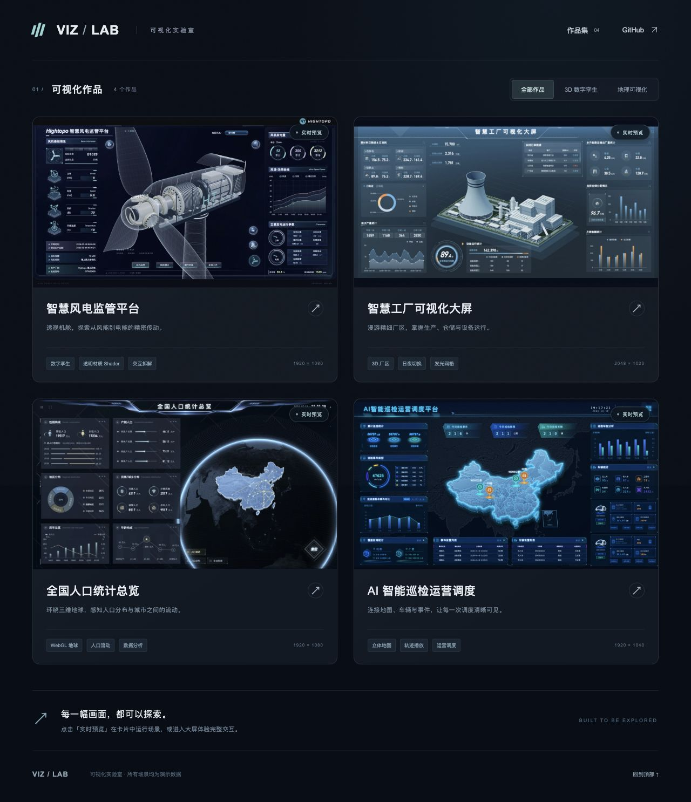
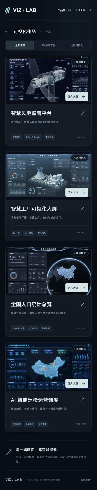
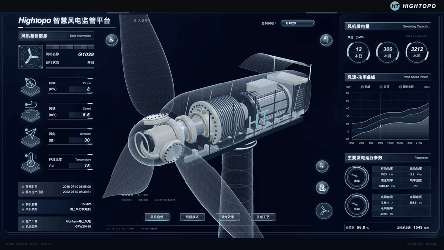
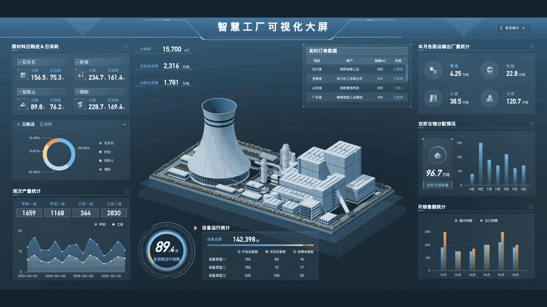
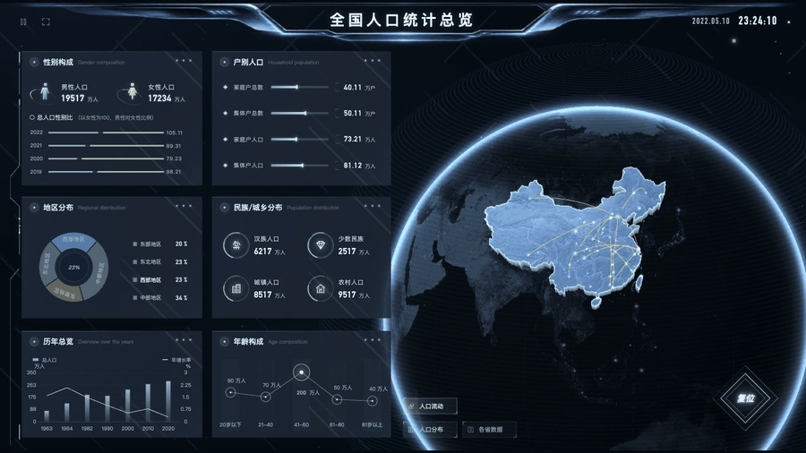
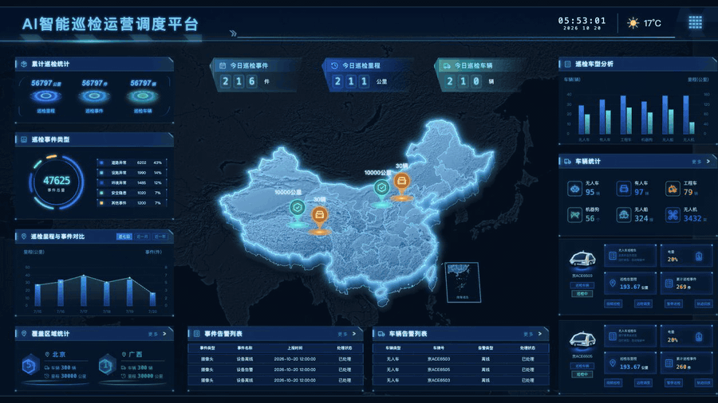

# VIZ / LAB · 可视化大屏展厅

**[打开 Home 展厅](https://yinweinidongle.github.io/screen-picture-demo/home.html)** · [GitHub 仓库](https://github.com/yinweinidongle/screen-picture-demo) · [下载完整源码](screen-picture-source.zip)

四个可交互大屏，一座可直接探索的作品展厅。Home 卡片显示实际大屏画面，支持类型筛选、卡片内实时预览与进入完整大屏；每次仅加载一个实时场景，兼顾展示和流畅度。

查看手机首页效果

 

## 大屏入口

| 大屏 | 核心体验 | 在线访问 |
| --- | --- | --- |
| 智慧风电监管平台 | Three.js 精密机组、透明机舱 Shader、爆炸拆解与发电流光 | [进入风电大屏](https://yinweinidongle.github.io/screen-picture-demo/wind.html) |
| 智慧工厂可视化大屏 | 立体厂区、菲涅耳轮廓光、极细发光网格与日夜扫光 | [进入工厂大屏](https://yinweinidongle.github.io/screen-picture-demo/factory.html) |
| 全国人口统计总览 | WebGL 地球、人口流动、人口分布与省级数据切换 | [进入人口大屏](https://yinweinidongle.github.io/screen-picture-demo/population.html) |
| AI 智能巡检运营调度 | 有厚度的中国地图、图表联动、车辆轨迹回放与运营调度 | [进入巡检大屏](https://yinweinidongle.github.io/screen-picture-demo/inspection.html) |

## 实际操作动画

以下 GIF 均从已实现的网页实际操作录制，点击对应入口可体验完整交互。

### 01 / 智慧风电

透明机舱内呈现轮毂变桨机构、主轴、齿轮箱、发电机、绕组与电控柜。自定义 Shader 提供菲涅耳边缘光、细网格和发电流光。支持旋转缩放、部件点选、启停、线框和带缓动的爆炸拆解。

### 02 / 智慧工厂

实际三维厂区支持拖动环绕、缩放、建筑点选和全景。日夜切换以从左向右的着色器扫光过渡，夜景使用细发光网格与柔和轮廓光。

[下载厂区 GLB 模型](https://yinweinidongle.github.io/screen-picture-demo/factory-campus.glb) · Khronos glTF Validator：0 错误、0 警告。

### 03 / 全国人口

三维地球与中国地图叠加人口流动弧线、城市节点和分布光柱，支持人口流动、人口分布、各省数据三种模式及统计图表交互。

### 04 / AI 智能巡检

中国地图包含立体厚度、边缘辉光和巡检节点。支持时间范围切换、事件筛选、车辆详情、轨迹播放、进度与速度调整。

## 使用与开发

- 直接访问 [Home](https://yinweinidongle.github.io/screen-picture-demo/home.html)，或下载各自的 HTML 独立打开。脚本、样式和所需纹理均已内嵌，不依赖外部 CDN。
- 下载并解压 [完整源码包](screen-picture-source.zip)，运行 `npm start`，然后访问 `http://127.0.0.1:5173/home.html`。需要 Python 3；重新构建需要 Pillow。
- `npm run build` 构建所有大屏与 Home。`build:wind`、`build:factory`、`build:population`、`build:home` 可独立构建。
- Home 的实时 iframe 预览建议使用 HTTP 或 GitHub Pages。大屏按设计比例适配窗口，横屏观看效果更佳。
- GitHub Pages 使用 `master` 分支根目录，提交后自动更新。根目录 `index.html` 与 `home.html` 均为作品展厅。

## 素材

| 文件 | 内容 |
| --- | --- |
| [home-preview.png](home-preview.png) | 桌面 Home 完整页面截图 |
| [home-mobile-preview.png](home-mobile-preview.png) | 手机单列布局截图 |
| [wind-demo.gif](wind-demo.gif) | 三维风机拆解、线框、流光与环绕 |
| [factory-demo.gif](factory-demo.gif) | 厂区日夜扫光与细网格发光 |
| [population-demo.gif](population-demo.gif) | 人口三维地球连续转动 |
| [inspection-demo.gif](inspection-demo.gif) | 巡检地图省份悬停与数据提示 |

页面数据与设备控制均为演示。三维场景按单张参考图重建，未提供原始 CAD 或三维资产；不可见结构和尺寸采用合理建模。

## 技术与许可

D3.js 7.9.0（ISC）、Three.js r160（MIT），内嵌版权声明保留。行政区边界来自阿里云 DataV，世界国界来自 Natural Earth；地球纹理来自 Three.js 官方示例；巡检地形来自 Esri。人口页眉、工厂降级图片与黑白网格纹理由 ImageGen 生成。实时风机与工厂几何由程序建模；README 图片和 GIF 为本项目实际网页录制。
