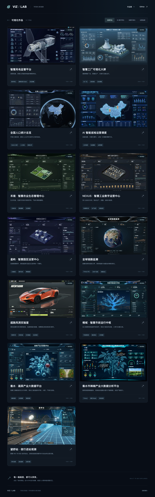

# VIZ / LAB — Interactive Dashboard Gallery

[Live gallery](https://yinweinidongle.github.io/screen-picture-demo/home.html) · [中文](../README.md) · [Contributing](../CONTRIBUTING.md)

Nine interactive scenes cover wind energy, a factory, population, inspection, agriculture, an automated workshop, a smart campus, a global relay network and a supercar wind tunnel. The gallery shows actual page captures and runs one live preview at a time.



AERO / LAB puts Arion Digital’s Lamborghini Aventador in a photographic HDR studio. Try the illustrated livery, follow the silver wind ribbons over the roof, or orbit the car as coloured tunnel lights sweep across the lacquer. On the three-lane test road, pairs of short cyan dashes travel outwards in waves. Each dash disappears against the first vehicle or guardrail it reaches. The car evaluates five seconds of predicted traffic to choose a route, drawn in blue and violet. Reset mixed traffic to run a different encounter. Self-contained GLBs can also be opened locally. [Open AERO / LAB](https://yinweinidongle.github.io/screen-picture-demo/aero-lab.html) · [Watch the demo](media/aero-lab-demo.gif) · [Controls and credits](screens/aero-lab.md)

Orbital Relay uses Three.js and TSL to render Earth's day and night sides, drifting clouds and luminous signal trails. Select one of six ground stations to follow its links and inspect simulated throughput and latency. [Open Orbital Relay](https://yinweinidongle.github.io/screen-picture-demo/earth-link.html) · [Rendering notes and captures](screens/earth-link.md)

Factory details: [English rendering guide](screens/factory.en.md).

The three new operations dashboards adapt owner-authorized procedural scenes from [big-screen-astra](https://github.com/yinweinidongle/big-screen-astra), with redesigned layouts, responsive charts, keyboard controls and lightweight fallbacks. See [implementation and provenance](astra-cases.md).

## Run locally

Install Node.js 22+ and Python 3.10+; CI uses Node 24 and Python 3.13.

```bash
git clone https://github.com/yinweinidongle/screen-picture-demo.git
cd screen-picture-demo
npm ci
npm run setup
npm run dev
```

Open `http://127.0.0.1:5173/home.html`. Source changes rebuild automatically; refresh to view them. `npm run setup` creates a project-local Python environment with the pinned Pillow version.

`npm run build` produces `dist/` with hashed, locally hosted web resources, `dist/standalone/` with embedded offline HTML, and a source ZIP. `npm start` serves an existing build. Use `npm run check`, `npm test`, `npm run format:check` and `npm run test:browser` before a PR. Install Chromium first with `npx playwright install chromium`.

Sources are in `src/screens/<id>/`; gallery metadata lives in `config/screens.json`. Run `npm run new:screen -- solar` for a registered starter. See [architecture](architecture.md), [the contribution guide](../CONTRIBUTING.md), and [the roadmap](../ROADMAP.md). Small improvements to charts, shaders, models, accessibility, tests and documentation are welcome.

Original code, procedural geometry and the factory grid use the MIT license. Maps and terrain come from public-domain Natural Earth data. Solar System Scope provides Orbital Relay's day, night and cloud textures under CC BY 4.0. Generated decoration, third-party software and composite previews have separate provenance. Controls and statistics are simulated. [Code license](../LICENSE) · [Third-party notices](../THIRD_PARTY_NOTICES.md)
