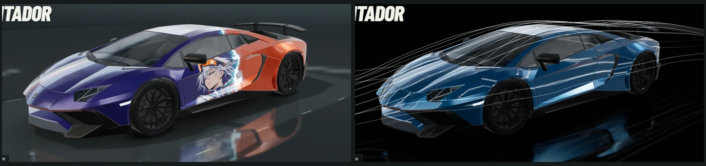
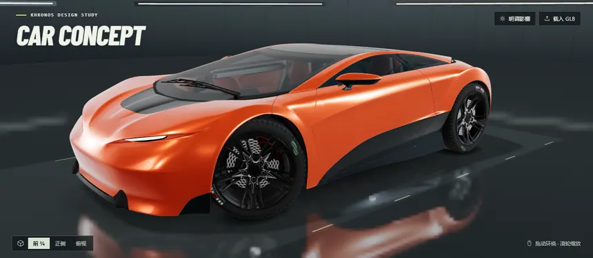

# 超跑风洞实验室 · AERO / LAB

中央的 Three.js 影棚展示 Khronos Car Concept。沿车身拖动可以检查反射、车漆过渡和绕流。桌面在同一屏排列涂层、风洞工况和气动力读数，手机竖屏把三个面板排在车辆下方。

## 车漆与镜头

- 选择熔岩橙、钛银、曜石黑、冰川蓝、赛道绿，或带银发赛车手贴花的「夜驰 · 动漫痛车」。切换时，约 2.6 秒的裁剪从前盖向车尾扩散。拖「裁剪位置」可以固定任意中间帧，也可以重播上一次换色。
- 拖动环绕，滚轮或双指捏合缩放。「前 ¾」「正侧」「俯视」提供三个固定机位。在画布上按方向键旋转、`+` / `−` 缩放、`Home` 复位。明暗影棚可在同一视角比较高光和轮胎接地阴影。
- 「载入 GLB」直接读取所选的自包含 glTF 2.0 二进制文件。车身材质名称含 paint、body 或 coat 的常规模型可切换涂层。导入失败时可以继续操作当前车辆。

影棚以摄影 HDRI、ACES 色调映射、清漆材质、软阴影和粗糙平面反射构成。玻璃、轮胎、内饰和车漆分别着色。过渡在世界坐标中计算一个带两层噪声的椭球距离场，先把裁剪区域写入模板缓冲，再在通过深度与模板测试的片元绘制新漆。两层漆都在裁剪边附近叠加冰白亮芯与青色光晕，旋转镜头时边界仍留在同一块车身钣金上。[车漆着色器](../../src/screens/aero-lab/finish.js) · [影棚照明](../../src/screens/aero-lab/studio.js)

## 风洞试验

在待机状态下拖动风速或偏角可预估读数。按「启动风洞」后气流逐步达到设定速度，暂停会保留当前流线和读数。「结束试验」返回待机。风速范围为 0–300 km/h，侧风偏角为 −15° 至 +15°。系统开启减少动态效果时，车辆即时换色，流线停在一个可检查的相位。

场景从当前车辆的网格采样 43 个纵向截面，用平滑后的车顶和侧面轮廓引导 24 条流线。风速控制脉冲速度，入流偏角改变流线偏移。迎风面积取自正面和侧面各 48 条水平带的轮廓包络，并按模型自身的米制尺寸换算。更换车辆会重新采样。

动压 `q = ½ρv²`，阻力 `F = q × Cd × A`。空气密度取 1.225 kg/m³，风速换算为 m/s。以偏航角 β 估算 `Cd = 0.32 + 0.16 sin²β` 及 `A = A正 cosβ + A侧 |sinβ|`。系数为演示假设，适合比较风速、侧风和模型轮廓的相对影响。工程验证需要实测或 CFD。公共模型在 160 km/h、零偏角时的迎风面积约 2.65 m²，动压约 1.21 kPa，阻力约 1.03 kN。[阻力方程](https://www1.grc.nasa.gov/beginners-guide-to-aeronautics/drag-equation/) · [气流与读数实现](../../src/screens/aero-lab/airflow.js)

## 资源与运行

`npm run build` 生成站点入口 `dist/aero-lab.html`，并把模型、HDRI、字体、人物贴图及脚本嵌入可直接打开的 `dist/standalone/aero-lab.html`。WebGL 2 不可用时显示影棚实拍，风速、偏角与气动估算仍可操作。公共模型有 213,347 个三角形，GLB 为 3,758,668 字节。桌面 Chromium、1920 × 1080 视口的常规环绕帧记录到 253 次绘制、444,392 个三角形，统计包含地面反射。

Car Concept 的模型与纹理由 Eric Chadwick 制作，© 2024 Darmstadt Graphics Group GmbH，基于 Unity Fan 的 CC0 原型，授权为 CC BY 4.0。保留模型上的原商标。本项目用 glTF Transform 4.5.1 的 `webp --quality 89` 和 `meshopt --level medium` 压缩资源。Studio Small 09 由 Sergej Majboroda 拍摄，Poly Haven 以 CC0 提供。Barlow Condensed 使用 SIL OFL 1.1。[模型固定版本](https://github.com/KhronosGroup/glTF-Sample-Assets/tree/7d4ba189827916452eeadc82d4b712dbc6280a6f/Models/CarConcept) · [摄影棚 HDRI](https://polyhaven.com/a/studio_small_09) · [署名与许可](../licensing/aero-lab-assets.txt)

### 动漫贴图

人物由内置 OpenAI ImageGen 为本项目文生图生成。透明 WebP 保留原画 Alpha，以车身高度确定印花尺寸，两侧投影朝向车头。印花颜色在物理着色前与底漆混合，油墨降低金属度，上方清漆保留影棚倒影。引擎将同一张图用于色卡和三维材质。[透明纹理原件](../../assets/art/aero-racer.webp)

生成提示词如下。

> Production artwork for an original Japanese motorsport itasha vinyl livery. One wide horizontal die-cut decal on real transparent alpha, 3:2 landscape canvas. A striking close-up bust of an adult female racing pilot, age 26, short layered ice-silver hair with dark violet underlayers streaming sharply to the RIGHT, luminous ice-blue eyes, composed confident smirk looking to the LEFT toward the car's nose, compact orange-tinted racing visor pushed onto her hair, zipped pearl-white and deep indigo high-collar technical racing suit, a little safety-orange tab. Single original character, mature angular features, elegant bold hand-inked Japanese anime key visual with precise dark navy linework, two-tone clean cel shading and screenprinted halftone patches. Strong readable face sits at x=42% y=43%, head and shoulders close crop with head fully intact, face occupies at least half the image height. Dynamic surrounding screenprint fragments sweep backward to the right as long, pointed, layered teal, pearl and vermilion-orange speed strokes. A dramatic compact angular silhouette that fills nearly all the canvas, opaque interior artwork, genuinely transparent outside the cut silhouette. Flat orthographic print-ready standalone ink artwork. No rectangle or poster background, no text, no brand logos, no watermark, no car mock-up, no shadow, no drop shadow, no neon blur, no duplicated face.
