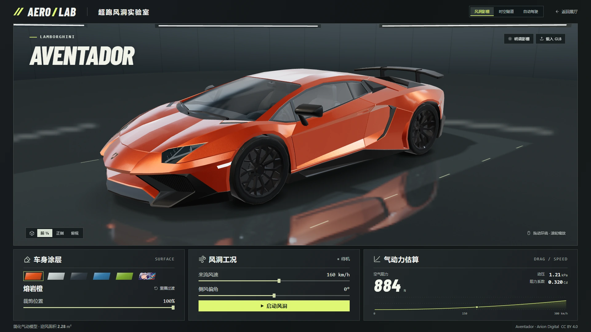
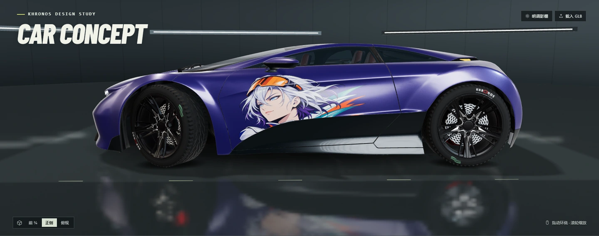
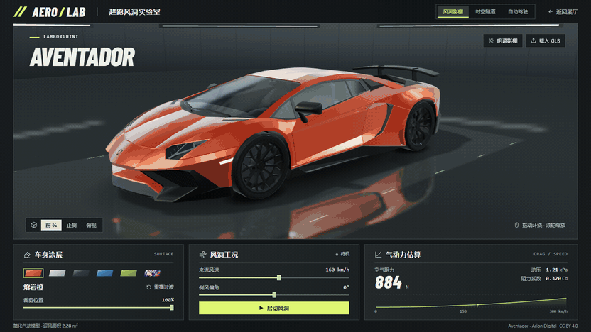

# 超跑风洞实验室 · AERO / LAB

中央的 Three.js 影棚展示 Arion Digital 制作的 Lamborghini Aventador。拖动环绕可检查反射、车漆过渡和绕流。顶部可以切换风洞、时空隧道和自动驾驶，仪表随场景显示气动力、速度曲线或雷达图。手机竖屏把面板排在车辆下方。

## 车漆与镜头

- 选择熔岩橙、钛银、曜石黑、冰川蓝、赛道绿，或带银发赛车手贴花的「夜驰 · 动漫痛车」。切换时，约 2.6 秒的裁剪从前盖向车尾扩散。拖「裁剪位置」可以固定任意中间帧，也可以重播上一次换色。
- 拖动环绕，滚轮或双指捏合缩放。「前 ¾」「正侧」「俯视」提供三个固定机位。在画布上按方向键旋转、`+` / `−` 缩放、`Home` 复位。明暗影棚可在同一视角比较高光和轮胎接地阴影。
- 「载入 GLB」直接读取所选的自包含 glTF 2.0 二进制文件。车身材质名称含 paint、body 或 coat 的常规模型可切换涂层。导入失败时可以继续操作当前车辆。

摄影 HDRI 与长条柔光箱共同决定车身倒影。带细小金属颗粒的底漆随观察角变色，外层清漆单独反射锐利高光。法线和粗糙度纹理按距离过滤，远景仍保留顺滑的腰线。换漆时，世界坐标中的双层噪声扰动椭球裁剪边界。通过模板与深度测试的车身片元显示新漆，两侧叠加冰白亮芯与青色光晕。[车漆着色器](../../src/screens/aero-lab/finish.js) · [反射环境](../../src/screens/aero-lab/lighting.js)

## 风洞试验

在待机状态下拖动风速或偏角可预估读数。按「启动风洞」后气流逐步达到设定速度，暂停会保留当前流线和读数。「结束试验」返回待机。风速范围为 0–300 km/h，侧风偏角为 −15° 至 +15°。系统开启减少动态效果时，车辆即时换色，流线停在一个可检查的相位。

送风时影棚转暗。8 条银白主线顺着引擎盖、风挡与车顶抬升，4 条较暗的流线绕过车肩，随后在车尾舒展。侧风改变它们的位置，来流速度决定亮纹沿线行进的快慢。曲线取自当前车辆网格的 43 个纵向截面和 19 条横向采样带。迎风面积按正面和侧面各 48 条水平带的轮廓包络换算，更换模型后重新采样。

车身前后各有一个局部反射探针，两者采集当前场景中的风线、隧道光束，或路面的规划线与雷达波。清漆与玻璃结合表面法线、视角及粗糙度采样，使掠过车门的反光随车身折面转折。场景播放时探针最高每秒更新 24 次，暂停后仍能绕车观察风线和隧道光束的倒影。[线条反射实现](../../src/screens/aero-lab/line-reflections.js)

动压 `q = ½ρv²`，阻力 `F = q × Cd × A`。空气密度取 1.225 kg/m³，风速换算为 m/s。以偏航角 β 估算 `Cd = 0.32 + 0.16 sin²β` 及 `A = A正 cosβ + A侧 |sinβ|`。系数为演示假设，适合比较风速、侧风和模型轮廓的相对影响。工程验证需要实测或 CFD。Aventador 在 160 km/h、零偏角时的模型迎风面积约 2.28 m²，动压约 1.21 kPa，估算阻力约 0.88 kN。[阻力方程](https://www1.grc.nasa.gov/beginners-guide-to-aeronautics/drag-equation/) · [气流与读数实现](../../src/screens/aero-lab/airflow.js)

## 驾驶场景

- **时空隧道**起步时镜头降到车头侧前方，292 束多色光迹随加速拉长。进场、穿梭和暂停期间均可拖动环绕，滚轮或双指捏合缩放。按「复位视角」或在画布上按 `Home` 可回到跟拍机位并保留行驶进度。目标速度范围为 100–320 km/h。[光迹着色器](../../src/screens/aero-lab/warp.js)
- **车流与规划**模拟三条车道和五辆交通车。「前方慢车」与「密集车流」便于复现超车和跟车。「混合车流」每次重置会改变车辆位置和速度，其他车辆会跟车，也会在间隙足够时并线。规划器每 0.2 秒根据雷达跟踪结果预测未来 5 秒的相对运动，组合候选车道、五次横向曲线和纵向速度，按车身间距、路界和侧向加速度筛选，再按进度、舒适性和间距选择路线。车辆执行同一条曲线，仪表显示可行轨迹数。[车流模拟](../../src/screens/aero-lab/driving.js) · [轨迹求解器](../../src/screens/aero-lab/planner.js)
- **环向雷达**用 512 个方向覆盖 360°，最远 68 米，每秒更新 10 次车辆观测。探测波从发射时的道路位置向四周扩散，碰到车身或护栏的那一段随即消失，其余部分继续传播。路面和右下雷达图共用各束波的碰撞距离。[探测与遮挡](../../src/screens/aero-lab/radar.js)
- **路线颜色**由片元 Shader 从近端电蓝经靛蓝连续过渡到远端紫罗兰。色带沿实际规划曲线铺在路面，两侧柔化，终点渐隐。右下雷达图使用相同的路线、配色和终点。[路面着色器](../../src/screens/aero-lab/road-scene.js)

两个驾驶场景均支持暂停、单步推进 0.75 秒和重置。启用系统“减少动态效果”时，场景先停在可检查的代表帧。按 `Esc` 或「返回影棚」恢复原机位与风洞工况。加速镜头参考了小米 SU7 网页体验的公开复现拆解。[SU7 效果复现作者的技术记录](https://alphardex.github.io/mygo/posts/17935/)

## 资源与运行

`npm run build` 生成站点入口 `dist/aero-lab.html`，并把模型、HDRI、字体、人物贴图及脚本嵌入可直接打开的 `dist/standalone/aero-lab.html`。WebGL 2 不可用时显示影棚实录，风速、偏角与气动估算仍可操作。Aventador 有 10,252 个三角形，GLB 为 2,602,712 字节。四个轮组各有独立轴心，按实际轮胎半径把行驶距离换算成转角。

Arion Digital 以 CC BY 4.0 发布模型与贴图。将固定版本的 GLB 下载到本地后，运行 `python scripts/prepare_aero_aventador.py source.glb assets/models/aero-aventador.glb` 可复现单位换算、轮心校准与材质分配。Studio Small 09 由 Sergej Majboroda 拍摄，Poly Haven 以 CC0 提供。Barlow Condensed 使用 SIL OFL 1.1。[作者的模型](https://sketchfab.com/3d-models/lamborghini-aventador-888e37a3641d4f7b94bc1a39396e2441) · [固定版本的 GLB](https://github.com/immx2/showcase-01/blob/af546ef179a1b8c2b1d4d00b01454fe6214f0126/public/models/lamborghini.glb) · [摄影棚 HDRI](https://polyhaven.com/a/studio_small_09) · [署名与许可](../licensing/aero-lab-assets.txt)

### 动漫贴图

人物由内置 OpenAI ImageGen 为本项目文生图生成。透明 WebP 保留原画 Alpha，以车身高度确定印花尺寸，两侧投影朝向车头。印花颜色在物理着色前与底漆混合，油墨降低金属度，上方清漆保留影棚倒影。引擎将同一张图用于色卡和三维材质。[透明纹理原件](../../assets/art/aero-racer.webp)

生成提示词如下。

> Production artwork for an original Japanese motorsport itasha vinyl livery. One wide horizontal die-cut decal on real transparent alpha, 3:2 landscape canvas. A striking close-up bust of an adult female racing pilot, age 26, short layered ice-silver hair with dark violet underlayers streaming sharply to the RIGHT, luminous ice-blue eyes, composed confident smirk looking to the LEFT toward the car's nose, compact orange-tinted racing visor pushed onto her hair, zipped pearl-white and deep indigo high-collar technical racing suit, a little safety-orange tab. Single original character, mature angular features, elegant bold hand-inked Japanese anime key visual with precise dark navy linework, two-tone clean cel shading and screenprinted halftone patches. Strong readable face sits at x=42% y=43%, head and shoulders close crop with head fully intact, face occupies at least half the image height. Dynamic surrounding screenprint fragments sweep backward to the right as long, pointed, layered teal, pearl and vermilion-orange speed strokes. A dramatic compact angular silhouette that fills nearly all the canvas, opaque interior artwork, genuinely transparent outside the cut silhouette. Flat orthographic print-ready standalone ink artwork. No rectangle or poster background, no text, no brand logos, no watermark, no car mock-up, no shadow, no drop shadow, no neon blur, no duplicated face.
