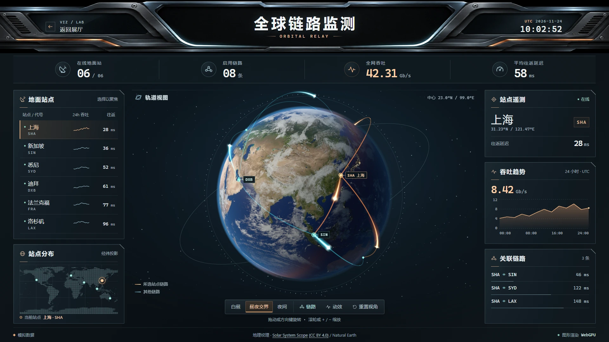
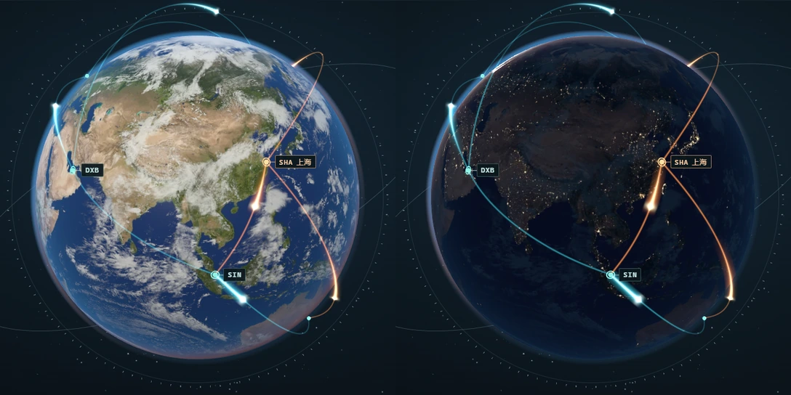
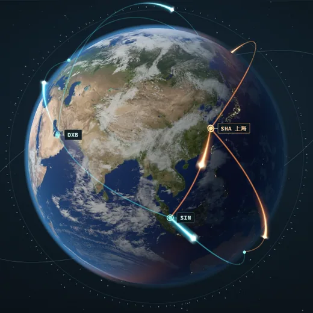

# 全球链路监测 · Orbital Relay

中央地球展示六座地面站和八条示意链路。点击站点列表、分布图或地球上的站点可以聚焦，右侧同步更新过去 24 小时的吞吐曲线和关联链路。吞吐以 Gb/s 表示，往返延迟以 ms 表示，数据取自本场景的固定演示样本。[演示数据](../../src/screens/earth-link/data.js)

## 地球与飞线

地球的 TSL 材质按表面法线与太阳方向的夹角混合日面、夜光和晨昏。云图独立漂移，地形法线和海面粗糙度保留陆地与海面的差异。切换「白昼」「昼夜交界」「夜间」可以在同一机位观察照明过渡。[Three.js 参考示例](https://threejs.org/examples/webgpu_tsl_earth.html) · [本场景材质](../../src/screens/earth-link/materials.js)

每条链路沿球面大圆弧抬升。TSL 根据弧长生成移动的亮核和向后渐细的尾迹。横向叠加窄亮芯、彩色光肩和宽而淡的光晕，辉光范围局限于飞线。所选站点的关联航线为铜色，其余为冰蓝。GSAP 驱动信号前进，信号到站后尾迹逐步收尽，再从起点发出。拖动地球、使用方向键或点选站点可固定观察角度。[弧线与动画](../../src/screens/earth-link/earth.js)

## 操作与渲染

- 拖动或按方向键旋转地球，滚轮或键盘 `+`、`−` 缩放。「重置视角」回到初始经纬度。
- 「动效」暂停或恢复信号、云层与自动环绕。「链路」控制航线显示。系统启用减少动态效果时，页面初始为静止状态。
- 桌面舞台为 1920 × 1080。手机竖屏先显示地球与控制条，向下滚动可查看站点和图表。
- 页面使用 WebGPU，也支持 WebGL 2。图形设备不可用时显示同一场景的透明实录，站点与图表仍可操作。离线文件为 `dist/standalone/earth-link.html`。

在 Chromium 的 WebGPU 后端，1920 × 1080 视口、设备像素比 1、初始镜头和全部链路开启时，地球画布为 1088 × 657，单帧为 24 次绘制、26,585 个三角形。可在 `#relay-earth` 的 `data-draw-calls` 和 `data-triangles` 属性中查看首帧统计。网站首次显示三维地球所需文件合计约 2.17 MB，按未压缩传输的文件字节计。嵌入纹理和脚本的离线 HTML 约 2.70 MB。

## 素材

Solar System Scope 提供日面、夜光与云图，采用 CC BY 4.0。地形法线与站点分布图使用 Natural Earth 公共领域数据。页面、静态地球和录屏均含本项目的材质与链路叠加。[原始贴图](https://www.solarsystemscope.com/textures/) · [CC BY 4.0](https://creativecommons.org/licenses/by/4.0/) · [署名与许可](../licensing/earth-link-assets.txt)

表头使用 ImageGen 生成的钛色面板。中心标题、返回入口、UTC 时钟由 HTML 排版，两翼的反光取自同一张底图。取原图在 (0, 242) 起始的 2114 × 248 区域，缩放为 1920 × 168 后导出 WebP。[表头底图](../../assets/art/earth-link-header.webp)

表头底图的生成提示词

> Use case: product-mockup. Create a single production raster background plate for the masthead of a premium orbital communications observatory. Orthographic front elevation, photoreal macro studio product render, impeccably machined dark titanium, smoked graphite ceramic inserts, a few low amber copper inlays, cool ice-blue reflected edge lighting. A single continuous, clean engineered instrument fascia spans the entire image horizontally. Mirrored gently stepped swept wings, precision-milled bevels, slim layered rails, a few fine fasteners and narrow dark vents restricted to the outer wings. The broad central 38% is a deep, completely blank matte midnight title recess with luminous understated pale-cyan rims sweeping inward beneath it and two subtle warm copper traces on outer wings. Outer left/right content bays are quiet dark glass. Soft grazing key lights visibly describe the metal, silver-blue bevel highlights, beautiful restrained material variation. Sophisticated aerospace hardware, jewel-like machining, industrial product photography. Composition is a horizontal 13:1 banner intended to occupy a 1920x146 header. If the render frame is taller, keep the entire detailed assembly inside one central shallow horizontal band occupying the middle quarter of the image height; the remaining top and bottom are plain near-black. The functional fascia goes all the way to left and right frame edges. No lettering, no symbols resembling text, no numbers, no typography, no interface data, no logos, no planets, no stars, no neon magenta, no screen mockup, no background scene, no watermark. Wide landscape.

