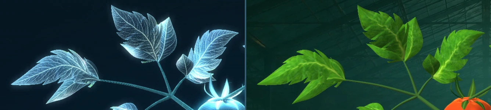

# 衡水 · 蔬菜产业大数据平台

[在线观测台](https://yinweinidongle.github.io/screen-picture-demo/verdant-lab.html) · [离线单文件](https://yinweinidongle.github.io/screen-picture-demo/standalone/verdant-lab.html)

中央的番茄以参考图中的正面株型为基准重建。上部的双果、中部的果簇、左右下垂的两枚底果与右侧红果构成默认视角。三维枝条、复叶、五角花萼和果实都可以绕看。参考图只提供了正面视图，背面分枝和动画时序由本项目设计。

下图截取同一视角的实际渲染。左侧为叶脉显影，右侧为温室自然光。

## 操作

- 在「叶脉显影」中观察细叶脉和果皮经纬网，切换「自然光」查看同一株番茄的叶面纹理与果皮。拖动旋转、滚轮缩放，使用复位按钮回到正面。聚焦植株后可用方向键旋转，按 Enter 查看果实。
- 图形按钮「观察标注」控制两张说明卡。「展开植株」放大中央视图。「暂停动效」控制植株和边框光流。系统设置减少动态效果时，页面以静帧开始。
- 切换「开花期」「膨果期」「转色期」查看同一株型的阶段示意。选择温室后，品种、定植株数、环境读数和对应的巡检视角同步更新。
- 水肥主阀和 A/B 配液阀使用演示状态。阀位按温室分别保存至本次页面会话。切换产销时段可比较入库、出库数据，聚焦图表后使用方向键逐组读数。
- 巡检区可在棚内通道、番茄果序、育苗苗床三张生成快照之间切换。

## 渲染与素材

Three.js 根据分枝曲线生成主茎、果柄和复叶。GLSL 材质为叶脉、果实经纬线和边缘高光分别着色。显影与自然光共用几何体和镜头。WebGL 不可用时，Canvas 2D 投影视图保留成像、旋转与果实选择。[植株骨架](../../src/screens/verdant-lab/specimen-model.js) · [Shader](../../src/screens/verdant-lab/specimen-shaders.js)

本屏使用 OpenAI ImageGen 生成六张素材。显影模式为深裂顶叶和卵形侧叶分别制作半透明图层。沿各自轮廓构建叶面，贴图中的主脉、侧脉和网脉随曲面转向。叶片取材于黑底、叶尖朝上的单片番茄叶，纹理保留中央叶脉、侧脉与叶肉明暗。温室空间采用傍晚玻璃顶种植棚，深色空置的中央过道为植株留出轮廓。巡检图由三个等宽视角组成。[叶面纹理](../../assets/art/verdant-leaf.webp) · [显影叶片图集](../../assets/art/verdant-veins.webp) · [温室空间](../../assets/art/verdant-glasshouse.webp) · [巡检图集](../../assets/art/verdant-cameras.webp)

页头按温室光谱仪额板设计，面板采用暗玉色拉丝金属和黄铜切角。每张图集分别保存底材和从同一条光槽提取的发光像素。移动遮罩沿嵌条显露亮芯与衰减的拖尾。面板分片缩放，保留角件的比例。页面和面板隐藏时暂停对应动画。[页头材质](../../assets/art/verdant-fascia.webp) · [面板材质](../../assets/art/verdant-bezel.webp) · [飞线](../../src/screens/verdant-lab/finish.js)

三个温室与相应数据均为演示设定。近 7 天和近 30 天的出入库共用同一组逐日样本，巡检图是静态快照，水肥开关仅更新页面状态。[数据与仪表](../../src/screens/verdant-lab/instruments.js) · [素材清单](../../assets/manifest.json)
